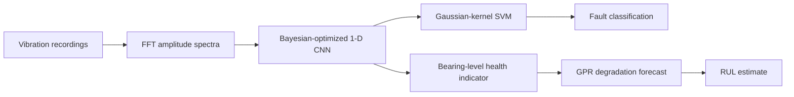
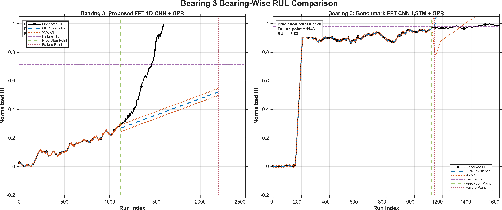

# Bearing Fault Diagnosis and RUL Prediction Using NASA IMS Data

MATLAB scripts and experimental results for bearing fault diagnosis, degradation assessment, and remaining useful life (RUL) prediction using the IMS bearing run-to-failure datasets distributed by NASA.

**Companion study**  
*Frequency-domain-based Bayesian-optimized 1-D CNN feature learning for integrated bearing fault diagnosis and remaining useful life prediction*

## Workflow

The 1-D CNN learns features from FFT amplitude spectra by distinguishing early-stage and late-stage recordings. Bayesian optimization jointly selects the initial learning rate, mini-batch size, L2 regularization coefficient, feature dimension, and convolutional filter counts.

The learned features support two tasks:

- **Fault diagnosis.** A Gaussian-kernel support vector machine (SVM) uses the channel-level features to classify bearing conditions.
- **RUL prediction.** Features are combined at the bearing level to construct a health indicator. Gaussian process regression (GPR) forecasts its trajectory, and RUL is estimated from the predicted threshold crossing. The CNN–LSTM benchmark uses the same downstream prognostic procedure.

## Repository Contents

| IMS dataset | CNN feature learning and SVM diagnosis | RUL comparison |
| :---: | --- | --- |
| **1** | [New_CNN_based_features_1st_Bearing](./New_CNN_based_features_1st_Bearing) | [CNN_vs_CNN-LSTM_RUL_1st_data](./CNN_vs_CNN-LSTM_RUL_1st_data) |
| **2** | [New_CNN_based_features_2nd_Bearing](./New_CNN_based_features_2nd_Bearing) | [CNN_vs_CNN-LSTM_RUL_2nd_data](./CNN_vs_CNN-LSTM_RUL_2nd_data) |
| **3** | [New_CNN_based_features_3rd_Bearing](./New_CNN_based_features_3rd_Bearing) | [CNN_vs_CNN-LSTM_RUL_3rd_data](./CNN_vs_CNN-LSTM_RUL_3rd_data) |

The folders contain MATLAB scripts, CSV performance summaries, classification reports, confusion matrices, and bearing-level RUL comparison figures.

### Example RUL Comparison

*IMS Dataset 1, Bearing 3. Comparison of the proposed FFT–1-D CNN and the FFT–CNN–LSTM benchmark.*

## Dataset

The Center for Intelligent Maintenance Systems (IMS) at the University of Cincinnati provided the vibration recordings. NASA distributes them through its Prognostics Data Repository. [Download the IMS bearing datasets](https://data.nasa.gov/dataset/ims-bearings).

To run feature learning, download the raw recordings separately and prepare the input `.mat` files. Each file must contain a MATLAB cell array named `Runs`. Store recordings in chronological order, with one recording per cell. Within each recording matrix, rows are time samples and columns are sensor channels.

## Getting Started

**Requirements:** MATLAB with Deep Learning Toolbox and Statistics and Machine Learning Toolbox. Parallel Computing Toolbox is required for GPU or parallel execution.

1. Download the IMS recordings and prepare the `Runs` input file for your dataset.
2. Set the MATLAB current folder to the corresponding feature-learning folder. Use one dataset folder at a time because some helper functions share filenames.
3. Check the input path in the feature-learning script, then run it to generate the CNN feature `.mat` file.
4. Run the matching SVM script to evaluate fault classification.
5. For RUL comparison, make the proposed CNN feature file and the benchmark CNN–LSTM feature file available to the corresponding RUL script, then run it from its dataset folder.

| IMS dataset | Feature learning | Fault classification | RUL comparison |
| :---: | --- | --- | --- |
| **1** | `Bayes_CNN_feature_01.m` | `CNN_feature_SVM_class_01.m` | `RUL_dataset_1st.m` |
| **2** | `Bayes_CNN_feature_02.m` | `CNN_feature_SVM_class_02.m` | `RUL_dataset_2nd.m` |
| **3** | `Bayes_CNN_feature_03.m` | `CNN_feature_SVM_class_03.m` | `RUL_dataset_3rd.m` |

> **Setup notes**
>
> - RUL comparisons require CNN–LSTM benchmark feature files, which must be supplied separately.
> - The third feature-learning script loads `IMS_4th_test_Runs.mat` and saves features with an `IMS_3rd_test` filename. The third RUL script expects `IMS_4th_test` feature filenames. Verify which recordings those names refer to and align the input and output filenames before running the comparison.

## Evaluation Scope

The models are tuned separately for each IMS dataset. The results therefore describe performance within each dataset under the study’s evaluation protocol. Transfer to an unseen dataset would require a separate evaluation.

The CNN is tuned using early-stage versus late-stage validation accuracy. The RUL results come from a retrospective analysis of completed run-to-failure recordings.

## Questions

For questions about dataset preparation, MATLAB scripts, or experimental outputs, [open a GitHub issue](https://github.com/hedayet13/Bearing-fault-diagnosis-and-RUL-prediction--NASA-IMS-Data/issues).
